<h1>
  <picture>
    <source media="(prefers-color-scheme: dark)" srcset="./type/name-dark.svg">
    
  </picture>
</h1>

<picture>
  <source media="(prefers-color-scheme: dark)" srcset="https://raw.githubusercontent.com/mohanvd/mohanvd/window/window-dark.svg">
  
</picture>

<h2>
  <picture>
    <source media="(prefers-color-scheme: dark)" srcset="./type/label-elsewhere-dark.svg">
    
  </picture>
</h2>

- [mohanadtarek.com](https://mohanadtarek.com)
- [auva.dev](https://auva.dev)
- [LinkedIn](https://www.linkedin.com/in/mohanadt/)
