<picture>
  <source media="(prefers-color-scheme: dark)" srcset="./window/window-dark.svg">
  
</picture>

## Hey, I'm Mohanad

I'm a software engineer in Alexandria, Egypt, in my last year of high school, so most of this gets built between classes and late at night. I co-run [Auva](https://auva.dev) with a few friends. It's our excuse to build whatever excites us, and to build it well.

## Where my code ends up

- **The browser.** Web apps with design systems I'm a little too strict about. TypeScript · Next.js · React · Tailwind · shadcn/ui
- **Discord.** Bots, dashboards and the communities around them. A lot of them speak Arabic. discord.js · Hono · MongoDB · Redis · Gemini
- **Small boards.** Radios and sensors on tiny boards, and the models that make sense of what they hear. Pico 2 W · nRF24L01 · MQTT · Python · scikit-learn
- **Where it runs.** Shipped on main, tagged, and kept alive somewhere I can watch it. Vercel · Railway · Supabase · Cloudflare R2 · Resend

## The window

The picture up top isn't a picture. It's [one Node file with no dependencies](./scripts/window.mjs), and GitHub Actions runs it every hour. Sunrise and sunset set the sky's colors, the moon shows its real phase, and the clouds, rain and fog are whatever Alexandria has right now. If the weather service is down, it works out the sun's position on its own.

Come back at night. The lighthouse turns on.

<a href="https://mohanadtarek.com">mohanadtarek.com</a> &nbsp;·&nbsp; <a href="https://auva.dev">auva.dev</a> &nbsp;·&nbsp; <a href="https://linkedin.com/in/mohanadt">LinkedIn</a>

